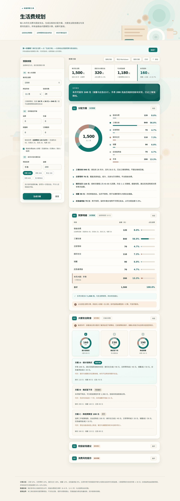
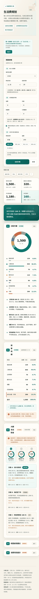

# 生活费规划助手

> 给在校大学生的**事前**月度预算工具。不是记账，是在花钱之前，先把这个月怎么分算清楚。



<p>

</p>

## 在线体验

直接打开：**https://ly18858.github.io/skill/college-budget-planner/web/index.html**

<p></p>

手机扫码可直接使用，页面自适应；断网时打开本地 `index.html` 功能一致。

## 它解决什么问题

- **月底靠感觉花钱**。多数学生没有月度预算，钱花到哪全凭印象，到月底才发现不够。
- **记账工具都是事后**。记账告诉你钱怎么没的，但不会在你下单前告诉你「这个月还剩多少可以花」。
- **通用预算模板不贴校园**。宿舍洗澡、饮水、洗衣、电费各走一个小程序，空调季和过渡季费用不同，食堂又是微信/支付宝直付——这些现实约束，通用模板一概不管。

这个工具只做一件事：**输入生活费与本月固定支出，输出一份对得上账、能直接执行的分配方案。**

## 三种形态，同一套规则

| 形态 | 入口 | 适合谁 | 金额怎么算 |
|---|---|---|---|
| **网页版** | `college-budget-planner/web/index.html` | 浏览器直接打开，也能手机用 | 页面内置内核 |
| **Agent Skill 版** | `college-budget-planner/` | CodeArts / Claude 等支持 Skill 的 Agent | Python 脚本计算 |
| **纯提示词版** | `prompt.md` | 任意对话工具，零配置 | 模型按规则算 |

三套共用同一套规则与取整口径。**不要同时使用**，否则多套逻辑会打架。网页内核与 Python 脚本由 456 组 golden test 守护一致性，见下文。

## 你会得到什么

固定五段，不多不少：

1. **月度分配方案**：三餐 52%、日常零碎 10%、娱乐社交 18%、储蓄 12%、应急 8%，作用于扣除固定开销与大额支出后的可分配金额。
2. **预算明细表**：逐项金额、占生活费比例，金额取整到 10 元，五项加和严格等于生活费。
3. **大额支出取舍**：触发时给 A/B/C 三套方案（按计划买 / 推迟下月 / 降配置），每套写明从哪里挪、代价是什么。
4. **校园省钱建议**：按用户情况挑 4–6 条，不全量罗列。
5. **消费风险提示**：按本月风险点挑 3–5 条。

支持多轮调整预算，也支持「超支了帮我复盘」。

## 怎么算的

```
生活费 − 固定开销（话费/交通/校园网/订阅 + 宿舍杂费） − 本月大额支出 = 可分配金额 R
```

- **三餐保障线** = 在校天数 × 30 元（默认 28 天 = 840 元），低于此线先保吃饭。
- **应急备用金**由尾差兜底，并校验落在 R 的 6%–10%；超出回拨储蓄。
- **五种预算状态**自动判定：`normal / tight / extreme_tight / meal_deficit / deficit`，不同状态下文案与建议不同。
- **闭合校验**：五板块 + 固定 + 大额 = 生活费，不平不出稿。

**宿舍杂费**按月份自动切换（长沙参考）：

| 子项 | 过渡季（3–5、10–11 月） | 空调季（6–9 制冷、12–2 取暖） |
|---|---|---|
| 洗澡热水 / 饮用水 / 洗衣 / 电费 | 40 / 25 / 25 / 30 | 45 / 25 / 30 / 60 |
| 合计 | **120** | **160** |

住宿费含在学年学费中，不计入月度。食堂微信/支付宝直付，宿舍三项各走独立小程序，先充值后扣款。

## 技术设计

**一个人能做完，是因为刻意砍掉了后端。** 没有服务器、没有数据库、没有账号体系，网页是单个 HTML 文件（72KB，0 处外部引用），断网可用。

- **计算与展示分离**：金额只由内核产生，文案只负责解释结果。边界情况（生活费低于三餐线、大额挤压吃饭）手算极易出错，所以全部交给确定性代码。
- **双实现一致性**：网页 JS 内核与 `budget_calc.py` 是两套独立实现。内核在 HTML 里用 `/*KERNEL-BEGIN*/ ... /*KERNEL-END*/` 标出，测试提取后交给 Node 执行，与 Python 逐字段对拍。
- **前端细节**：环形图与占比条、三方案对比环图、卡片折叠、深色模式（跟随系统 + 手动切换）、`aria-live` / `aria-invalid`、WCAG AA 对比度、输入防抖。

## 验证

| 检查 | 规模 | 内容 |
|---|---|---|
| `tests/golden_test.py` | 456 组 | JS 内核 vs Python：五板块金额、模式、R、三餐线、合计、闭合、触发标记 |
| `tests/ui_test.py` | 31 项 | XSS 转义、占比加和 100.0%、折叠、引导、深色、chips、防抖、aria |
| `check_web.py` | 6 组场景 | 浏览器端数值对拍 + 保存/重置 + 截图 |

数值对拍覆盖空调季、免宿舍费、低保预算、极端缺口等边界。项目里没有"应该是对的"，只有"跑过是对的"。

## 快速开始

**网页版**：直接打开在线页面，或用浏览器打开本地 `college-budget-planner/web/index.html`。

**Skill 版**：

```bash
mkdir -p ~/.codeartsdoer/skills
cp -r college-budget-planner ~/.codeartsdoer/skills/
```

然后说「帮我规划一下这个月生活费」「1500 能买这个吗」「超支了帮我复盘」即可触发。

**单独跑计算脚本**：

```bash
python3 college-budget-planner/scripts/budget_calc.py \
  --living 1500 --fixed 0 --big 200 --month 11 --days 28
```

| 参数 | 含义 |
|---|---|
| `--living` | 每月生活费（元），必填 |
| `--fixed` | 宿舍杂费以外的固定开销（话费+交通+校园网+订阅） |
| `--big` | 本月大额支出 |
| `--month` | 1–12，用于判定空调季 / 过渡季 |
| `--days` | 在校天数，默认 28 |
| `--no-dorm` | 宿舍杂费不由本人承担时加上 |
| `--json` | 输出结构化结果，便于对拍 |

## 适用边界

- 不做记账，不管理历史账单。
- 不推荐贷款、网贷、信用卡分期、花呗、理财产品、刷单兼职、彩票。
- 不评判消费选择，只谈预算影响。
- 只覆盖本月及下月，不做长期财富规划。
- 物价为长沙高校常见的参考区间，用户提供真实数字时以用户为准。

## 目录结构

```text
.
├── README.md
├── demo.md                        # 3 分钟演示动线
├── prompt.md                      # 纯提示词版
├── check_web.py                   # 浏览器端对拍与截图
├── tests/
│   ├── golden_test.py             # JS 内核 vs Python，456 组
│   └── ui_test.py                 # 31 项行为验证
└── college-budget-planner/        # Skill 版
    ├── SKILL.md                   # 唯一入口：工作流、规则、安全约束
    ├── scripts/budget_calc.py     # 计算内核
    ├── web/                       # 单文件网页版 + 预览图
    └── references/                # 规则、物价锚点、输出模板
```

## 测试

```bash
python3 -m http.server 8765          # 先起本地服务
python3 tests/golden_test.py         # 456 组规则对拍
python3 tests/ui_test.py             # 31 项行为验证
python3 check_web.py                 # 浏览器数值对拍 + 截图
```

## 许可

MIT，见 [LICENSE](LICENSE)。